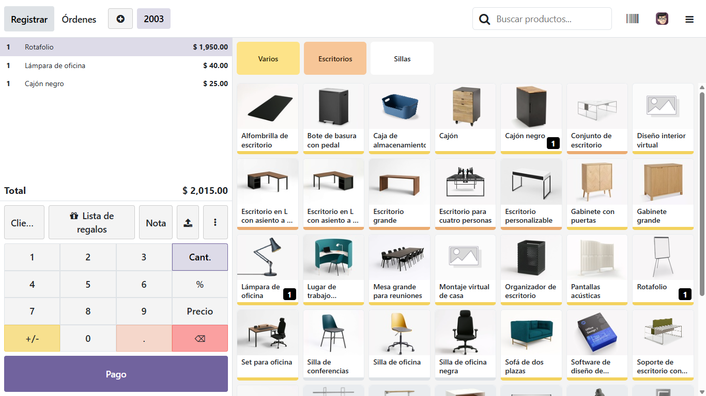
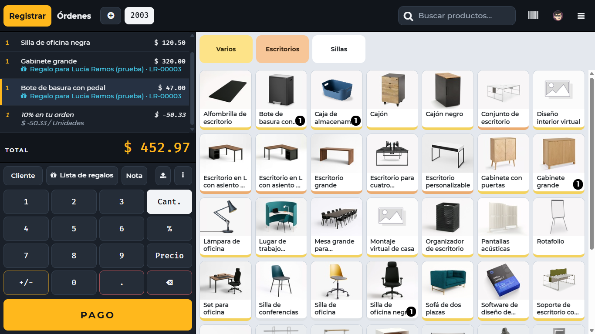
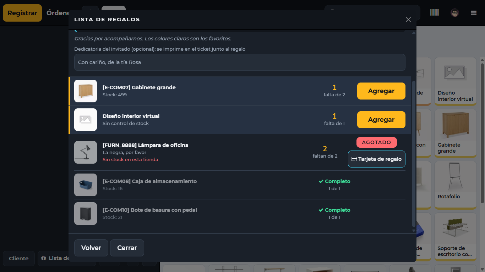
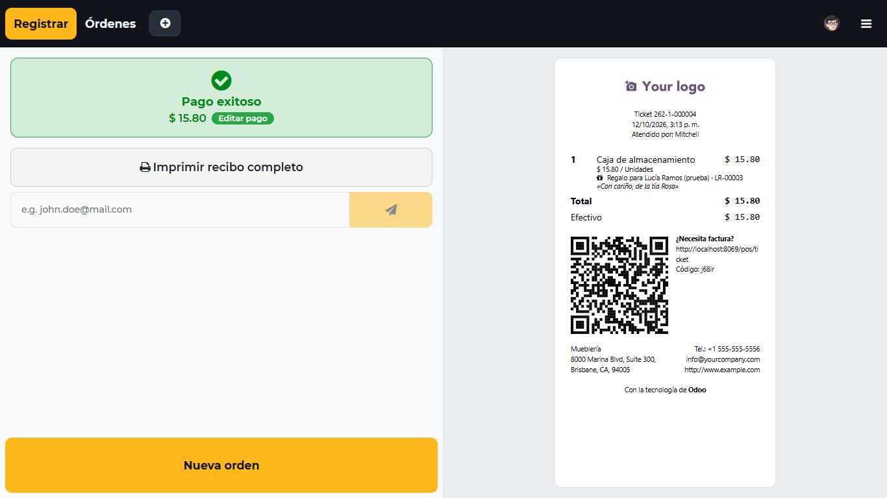
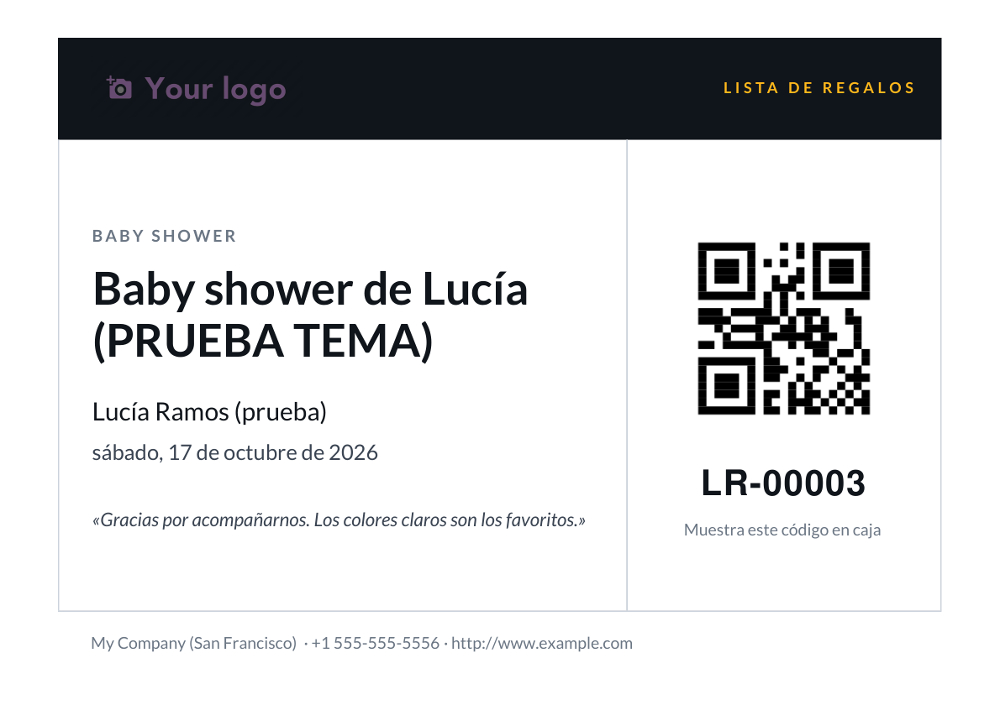

# Lista de regalos para Odoo 19 · Macromec

Módulos propios para **Odoo 19 Community** que permiten a una tienda llevar listas de regalos (bodas, baby showers, cumpleaños) y venderlas desde el Punto de Venta, más un tema visual para la caja. Incluye el entorno de desarrollo con Docker y las pruebas automatizadas.

> **Estado:** desarrollado y probado en un entorno local (Docker, base con datos de demostración). **No se ha instalado en producción** ni se ha probado con la localización peruana. Antes de llevarlo a producción, lee [docs/produccion.md](docs/produccion.md).

## Qué hace

- **Listas de regalos** con dueño, tipo de evento, fecha, productos deseados y consentimiento de datos personales.
- **Venta desde la caja:** el cajero busca la lista por código, DNI o nombre, ve qué falta y agrega el regalo al ticket.
- **Ticket con leyenda:** cada regalo sale en el ticket como "Regalo para …", con una dedicatoria opcional del invitado.
- **Avance automático:** al cobrar, la lista descuenta lo regalado; una devolución lo repone.
- **Avisos al personal:** cada mañana, qué eventos son hoy y cómo va cada lista; y un aviso cuando un regalo se excede.
- **Tarjeta imprimible** con el código de la lista y un QR, para que el dueño la comparta.
- **Tema de la caja:** ticket oscuro de alto contraste, total grande y botones cómodos para pantalla táctil.

## Cómo se ve

Todas las imágenes son capturas reales del entorno local, con datos de demostración.

**La caja, antes y después del tema**

| Aspecto estándar de Odoo | Con el tema `macromec_pos_theme` |
| --- | --- |
|  |  |

En el ticket de la derecha se ven dos regalos de una lista (con su leyenda en celeste) y el descuento del 10 % de la promoción.

**El diálogo de Lista de regalos**



Arriba, de quién es la lista y su avance (un segmento por regalo). Debajo, primero lo pendiente con su botón "Agregar"; después lo agotado, con la alternativa de una tarjeta de regalo; al final lo ya cubierto.

**El ticket y la tarjeta para compartir**

| Recibo con leyenda y dedicatoria | Tarjeta PDF de la lista |
| --- | --- |
|  |  |

Más capturas, paso a paso, en la [guía de uso](docs/guia-de-uso.md).

## Los cuatro módulos

Están en la carpeta [`addons/`](addons).

| Módulo | Qué aporta | Depende de |
| --- | --- | --- |
| `gift_registry` | El núcleo: listas, productos, tipos de evento, consentimiento, correos, avisos, tarjeta PDF y reportes | `mail`, `stock` |
| `gift_registry_pos` | La caja: botón, diálogo de búsqueda, leyenda y dedicatoria en el ticket | `gift_registry`, `point_of_sale` |
| `gift_registry_sale` | Cuenta como regalo lo vendido desde pedidos de venta | `gift_registry`, `sale_stock` |
| `macromec_pos_theme` | La apariencia de la caja. Se puede desinstalar y la caja vuelve al aspecto estándar | `point_of_sale`, `gift_registry_pos` |

## Empezar en tu PC

Necesitas **Docker Desktop** encendido. Los comandos son para la consola CMD de Windows, desde la carpeta del repositorio.

**1. Levantar Odoo y PostgreSQL**

```cmd
docker compose up -d
```

**2. Crear una base de datos de trabajo con datos de demostración**

```cmd
docker compose run --rm odoo odoo -d regalos_dev -i point_of_sale,stock,sale_management --with-demo --load-language=es_PE --stop-after-init --no-http
```

**3. Instalar los módulos**

```cmd
docker compose run --rm odoo odoo -d regalos_dev -i gift_registry_pos,gift_registry_sale,macromec_pos_theme --stop-after-init --no-http
docker compose restart odoo
```

**4. Entrar**

Abre <http://localhost:8069>, elige la base `regalos_dev` y entra con el usuario `admin` y la contraseña `admin` (credenciales de demostración, válidas solo en este entorno local).

Los comandos del día a día (apagar, actualizar un módulo, correr las pruebas) están en [docs/instalacion-y-comandos.md](docs/instalacion-y-comandos.md).

## Pruebas

Hay **25 pruebas automatizadas**. 24 corren con la imagen oficial de Odoo; la número 25 es una prueba de pantalla que abre la caja en un navegador y necesita una imagen de pruebas con Chrome. Cómo ejecutar ambas: [docs/instalacion-y-comandos.md](docs/instalacion-y-comandos.md#pruebas).

## Documentación

| Documento | Para qué sirve |
| --- | --- |
| [Guía de uso](docs/guia-de-uso.md) | Cómo crear una lista, venderla en la caja y qué ve cada persona |
| [Instalación y comandos](docs/instalacion-y-comandos.md) | Docker, comandos habituales, pruebas y problemas conocidos |
| [Antes de producción](docs/produccion.md) | Lista de verificación, la promoción de inauguración y lo pendiente |
| [Cómo está hecho](docs/desarrollo.md) | Estructura de cada módulo, decisiones técnicas e historial de cambios |

## Estructura del repositorio

```
.
├── addons/                      Módulos propios (lo que Odoo carga)
│   ├── gift_registry/
│   ├── gift_registry_pos/
│   ├── gift_registry_sale/
│   └── macromec_pos_theme/
├── docs/                        Guías y capturas
├── docker-compose.yml           Odoo 19 + PostgreSQL 16 para desarrollo
├── Dockerfile.pruebas           Imagen solo para pruebas de pantalla (Odoo + Chrome)
└── docker-compose.pruebas.yml   Servicio que usa esa imagen
```

## Licencia y créditos

Los módulos declaran la licencia **LGPL-3** en su manifiesto. Las fuentes del tema (Montserrat y Fira Mono) se distribuyen bajo la **SIL Open Font License**; sus textos están en `addons/macromec_pos_theme/static/fonts/`.
