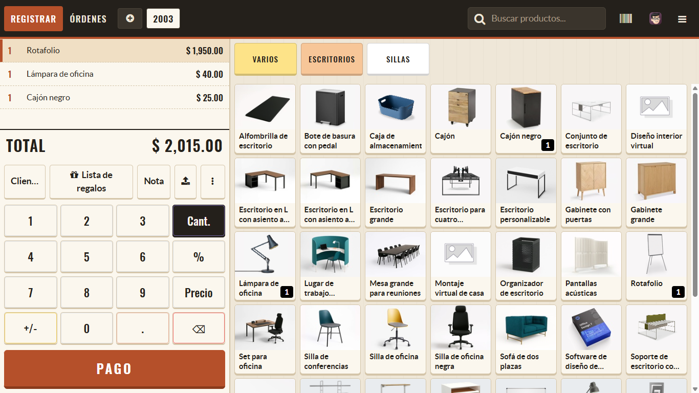
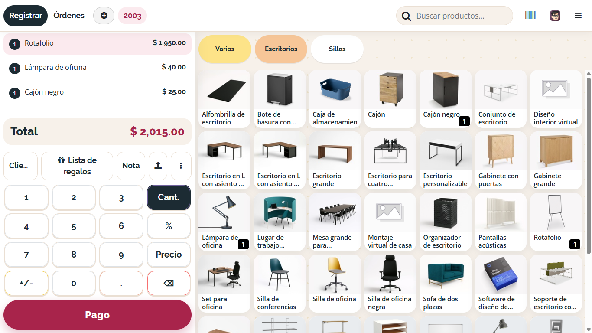
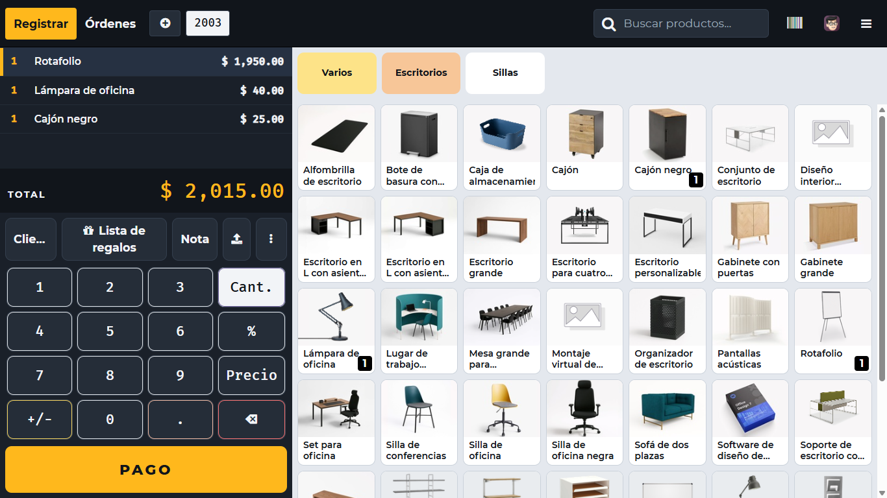
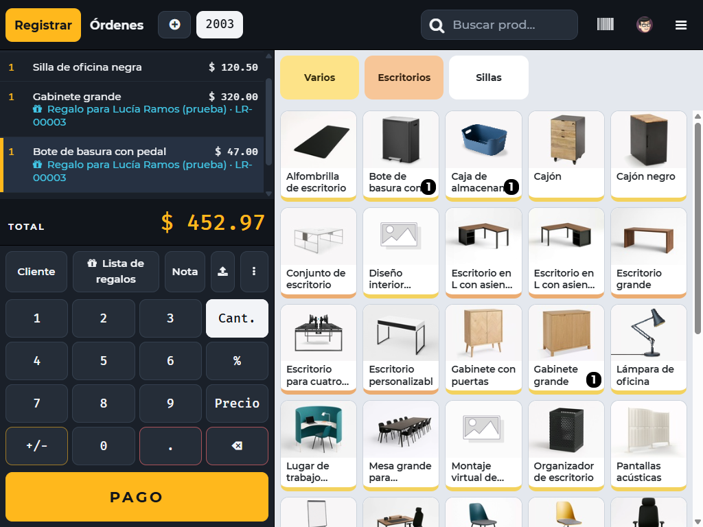

# Cómo está hecho

Para quien vaya a mantener o ampliar los módulos: qué hay en cada uno, por qué se tomaron ciertas decisiones y cómo ha ido cambiando.

- [Modelo de datos](#modelo-de-datos)
- [Módulo por módulo](#módulo-por-módulo)
- [Decisiones técnicas](#decisiones-técnicas)
- [Mantener el tema](#mantener-el-tema)
- [Cómo se eligió el diseño](#cómo-se-eligió-el-diseño)
- [Historial de cambios](#historial-de-cambios)

## Modelo de datos

| Modelo | Qué representa | Campos clave |
| --- | --- | --- |
| `gift.registry` | Una lista de regalos | `name` (código LR-…), `title`, `partner_id` (dueño), `event_type_id`, `event_date`, `state`, `privacy`, `user_id` (responsable), `line_ids` |
| `gift.registry.line` | Un producto deseado | `product_id`, `qty_wanted`, `qty_gifted`, `qty_pending`, `status` |
| `gift.registry.event.type` | Tipo de evento | `name`, `template_line_ids` (productos sugeridos) |
| `pos.order.line` (extendido) | Línea de venta de la caja | `gift_registry_line_id`, `gift_message` (dedicatoria) |
| `sale.order.line` (extendido) | Línea de pedido de venta | `gift_registry_line_id` |

**Estados de una lista:** borrador → activa → cerrada, o cancelada.
**Estados de una línea:** pendiente, parcial, completa o excedida. Se calculan solos a partir de lo vendido.

**Cómo se cuenta lo regalado.** El núcleo define `gift.registry.line._get_gifted_qty()`, que devuelve 0. Cada canal lo extiende y suma lo suyo: `gift_registry_pos` suma las líneas de pedidos de caja cobrados (las devoluciones tienen cantidad negativa y restan solas) y `gift_registry_sale` suma los pedidos de venta confirmados menos lo devuelto. Así el núcleo no depende de ningún canal y se pueden añadir otros.

## Módulo por módulo

### `gift_registry`

```
models/      gift_registry.py, gift_registry_line.py, gift_registry_event_type.py
views/       formularios, listas, buscador, calendario, menús
data/        secuencia LR-, tipos de evento, plantillas de correo, tareas programadas
report/      análisis en SQL (pivotes) y la tarjeta PDF con QR
security/    grupos Vendedor y Administrador, reglas por empresa
tests/       aviso diario, productos sugeridos, tarjeta, datos del dueño
```

- **Tareas programadas:** cerrar listas vencidas, recordatorio al dueño 7 días antes, y el aviso diario de eventos de hoy.
- **Avisos al personal:** `_cron_event_today_activity()` y `gift.registry.line._notify_exceeded()` crean actividades "Por hacer". Cada uno guarda una marca (`event_notice_date`, `exceeded_notified`) para no duplicarse.
- **Tarjeta PDF:** `report/gift_registry_card.xml`. El QR se genera dentro del reporte y va incrustado, sin pedir la imagen al servidor.

### `gift_registry_pos`

```
models/                    campos en pos.order.line, carga de datos para la caja, búsqueda
static/src/components/     el diálogo de Lista de regalos (JS, plantilla, estilos)
static/src/overrides/      botón en la caja y leyenda en la línea del ticket
static/tests/tours/        la prueba de pantalla
tests/                     pruebas del servidor y lanzador del tour
```

- **Búsqueda:** `gift.registry.search_for_pos()` en el servidor. Con conexión, el diálogo muestra lo que devuelve; sin conexión, filtra por código o nombre lo que la caja cargó al abrirse.
- **Privacidad en la caja:** a la caja no viaja el DNI. El servidor es el único que lo compara.
- **Leyenda y dedicatoria:** una extensión de la plantilla `point_of_sale.Orderline`, la misma que usan el ticket en pantalla y los recibos.

### `gift_registry_sale`

Enlaza líneas de pedidos de venta con líneas de lista y avisa del exceso al confirmar.

### `macromec_pos_theme`

Solo estilos y fuentes; no tiene modelos ni vistas.

```
static/src/scss/primary_variables.scss     color principal, letra y radios
static/src/scss/fonts.scss                 declaración de las fuentes
static/src/scss/pos_theme.scss             barra superior, ticket, botones, productos
static/src/scss/gift_registry_dialog.scss  piel del diálogo de regalos
static/fonts/                              Montserrat y Fira Mono (licencia OFL)
tests/                                     los estilos compilan y las fuentes existen
```

## Decisiones técnicas

**El contenido del diálogo va en `gift_registry_pos`; la apariencia, en el tema.** La barra de avance, las fotos y los estados son funciones del módulo de regalos. El tema solo les pone color y letra. Por eso, al desinstalar el tema, el diálogo conserva sus mejoras con el aspecto estándar de Odoo.

**"Cubiertos" se cuenta producto por producto.** Tanto el aviso diario como la caja suman, por cada producto, lo regalado sin pasar de lo deseado. Un producto regalado de más no compensa a otro que falta.

**La fecha de "hoy" es la de Perú.** El servidor trabaja en UTC, que a partir de las 7 p. m. de Lima ya es el día siguiente. La tarea del aviso diario envía la zona `America/Lima` en su propio código, editable en Ajustes › Técnico › Acciones planificadas.

**Los avisos se envían con permisos de sistema.** Quien cobra o confirma un pedido puede no ser administrador de listas; en un pedido web ni siquiera es un empleado.

**"Agotado" solo aplica a productos con inventario.** Un servicio no tiene stock y no debe bloquearse.

**La tarjeta de regalo se detecta en tiempo de ejecución.** El diálogo mira si la caja cargó un programa de tarjetas de regalo. Así `gift_registry_pos` no depende del módulo de promociones.

**La prueba de pantalla se omite sin navegador.** Odoo la salta si no encuentra Chrome, de modo que el comando habitual de pruebas funciona con la imagen oficial.

## Mantener el tema

El tema se apoya en tres mecanismos de Odoo, para depender lo menos posible de su estructura interna:

1. **Variables con `!default`.** Odoo declara su color principal, su letra y sus radios con `!default`. `primary_variables.scss` se carga al principio del paquete de estilos de la caja y fija esos valores antes; Odoo los respeta. No se modifica ningún archivo suyo.
2. **Propiedades de los botones.** La caja pinta los botones con propiedades como `--btn-bg`. El tema cambia esas propiedades en lugar de forzar estilos.
3. **Zonas acotadas.** Lo oscuro se limita a la barra superior y al ticket de la pantalla de productos. El resto (pago, órdenes, diálogos de Odoo) sigue claro, y el recibo impreso conserva su letra.

Cosas a recordar si se toca:

- **Para cambiar la marca**, edita la paleta al inicio de `pos_theme.scss` y el color principal en `primary_variables.scss`.
- **Rutas de fuentes:** en los estilos de Odoo, `url(...)` debe ser relativa al archivo y escrita tal cual, sin variables. Odoo la reescribe al empaquetar; si no, apunta a una dirección que no existe.
- **Nombres de fuentes:** el tema declara "Macromec Sans" y "Macromec Mono" porque Odoo ya declara "Montserrat" y "Fira Mono" con otros pesos.
- **`!important` solo aparece** donde Odoo usa clases utilitarias que ya lo llevan (`bg-view`, `bg-100`, `rounded-0`).
- **Tras actualizar Odoo**, corre las pruebas: una comprueba que los estilos siguen compilando con el tema. Después revisa la caja a ojo, en especial la barra superior y el ticket.

## Cómo se eligió el diseño

Antes de programar el tema se prepararon tres direcciones, aplicando estilos de boceto sobre la caja real:

| A · Taller | B · Regalo | C · Mostrador |
| --- | --- | --- |
|  |  |  |
| Madera, papel y terracota | Boutique clara, frambuesa y dorado | Ticket oscuro de alto contraste y ámbar |

Se eligió la **C**. Es la que más estilos propios necesita, porque oscurece zonas que Odoo dibuja claras, y por eso es también la que más conviene revisar tras cada actualización de Odoo.

Así se ve en un monitor táctil de caja típico, de 1024 × 768:



## Historial de cambios

El punto de partida fue un código base de tres módulos con 4 pruebas. Cada mejora tiene su propio commit; `git log` muestra el detalle.

| Cambio | Módulos |
| --- | --- |
| Estado inicial probado | los tres originales |
| Autor Macromec y versión 19.0.1.1.0 | los tres |
| Aviso diario de eventos de hoy; campo "Responsable"; filtro "Evento hoy" | `gift_registry`, `gift_registry_pos` |
| Corrección: la búsqueda por DNI en la caja no mostraba resultados | `gift_registry_pos` |
| Diálogo de Lista de regalos con avance, fotos y estados | `gift_registry_pos` |
| Tema "Mostrador" para la caja | `macromec_pos_theme` (nuevo) |
| Aviso a los administradores cuando un regalo se excede | los tres |
| Productos sugeridos por tipo de evento | `gift_registry` |
| Dedicatoria del invitado | `gift_registry_pos`, tema |
| "Agotado" solo con inventario; sugerencia de tarjeta de regalo | `gift_registry_pos`, tema |
| Tarjeta PDF con QR | `gift_registry` |
| Datos personales del dueño: menos exposición | `gift_registry` |
| Prueba de pantalla (tour) | `gift_registry_pos` |
| Raíz del repositorio en la carpeta del proyecto; archivos de Docker | repositorio |
