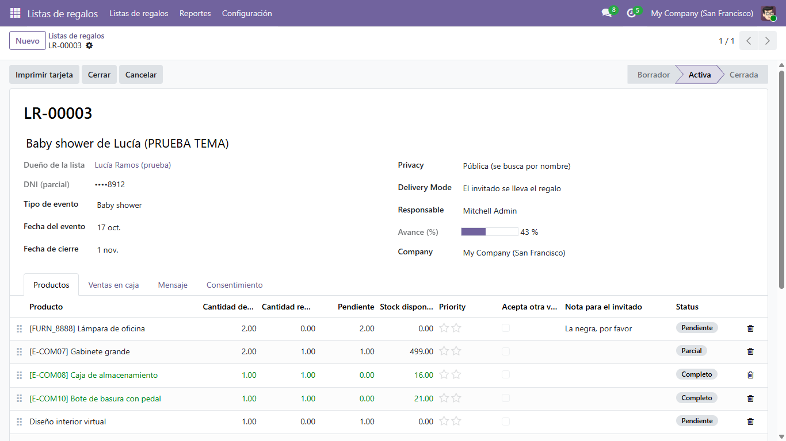
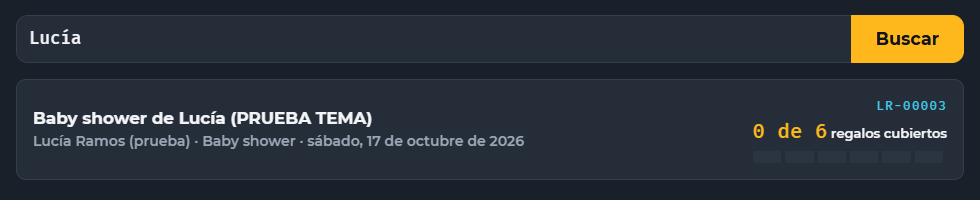
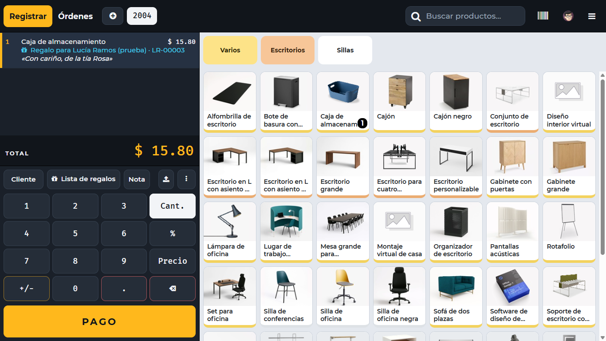
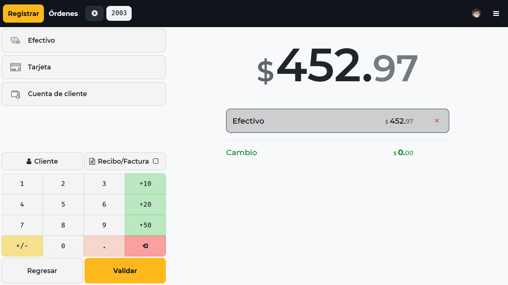
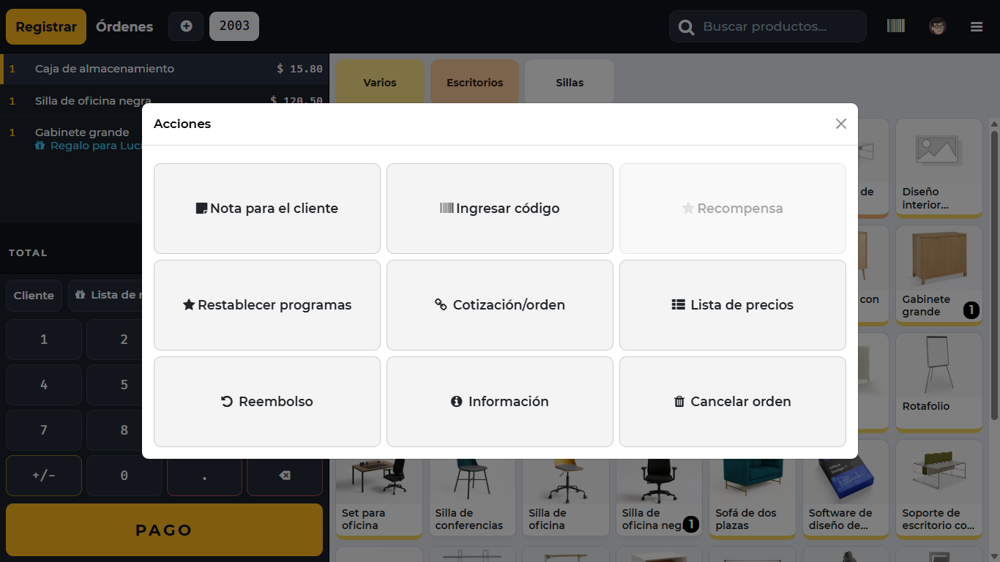
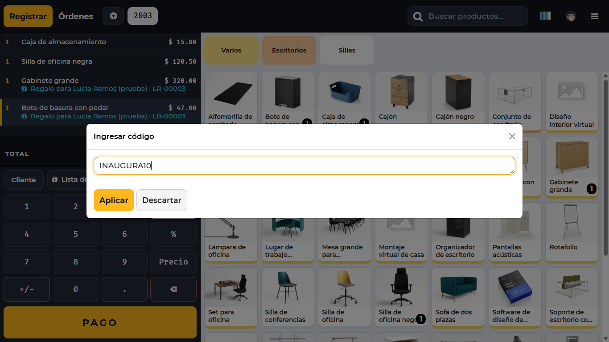
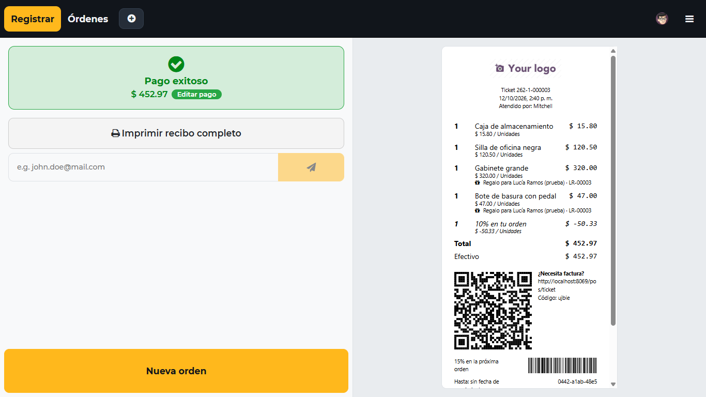
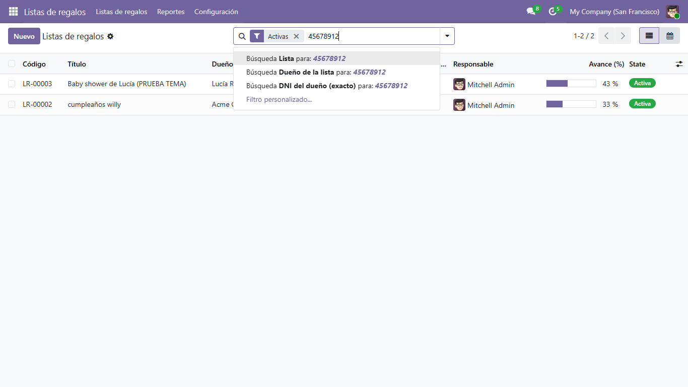

# Guía de uso

Cómo se trabaja con las listas de regalos, de principio a fin. Las capturas son reales, tomadas en el entorno local con datos de demostración.

- [Quién hace qué](#quién-hace-qué)
- [1. Crear una lista (oficina)](#1-crear-una-lista-oficina)
- [2. Vender un regalo (caja)](#2-vender-un-regalo-caja)
- [3. Cobrar y entregar el ticket](#3-cobrar-y-entregar-el-ticket)
- [4. Qué pasa después de la venta](#4-qué-pasa-después-de-la-venta)
- [5. Avisos al personal](#5-avisos-al-personal)
- [6. Buscar listas y ver reportes](#6-buscar-listas-y-ver-reportes)

## Quién hace qué

Hay dos permisos, en **Ajustes › Usuarios**, bajo "Listas de regalos":

| Permiso | Puede | No puede |
| --- | --- | --- |
| **Vendedor** | Crear y editar listas, venderlas en caja, imprimir la tarjeta | Ver listas canceladas, cancelar listas, abrir la ficha completa del dueño desde la lista, ver reportes |
| **Administrador** | Todo lo anterior, cancelar y reabrir listas, configurar tipos de evento, ver reportes | — |

Todo usuario del Punto de Venta recibe el permiso de Vendedor automáticamente.

## 1. Crear una lista (oficina)

Menú **Listas de regalos › Listas de regalos › Nuevo**.

1. Escribe el **título** (por ejemplo "Baby shower de Lucía") y elige al **dueño de la lista**. Si no existe, se puede crear en el momento.
2. Elige el **tipo de evento** y la **fecha del evento**. La fecha de cierre se calcula sola: 15 días después del evento.
3. Decide la **privacidad**:
   - *Pública*: en la caja se encuentra también por el nombre del dueño o el título.
   - *Privada*: solo se encuentra con el código o el DNI exacto.
4. En la pestaña **Productos**, agrega lo que el dueño desea y cuántas unidades. Puedes anotar una nota para el invitado y marcar si acepta otra variante.
5. En la pestaña **Consentimiento**, marca que el dueño acepta el tratamiento de sus datos. Sin esa casilla la lista no se puede activar.
6. Pulsa **Activar**. La lista recibe su código (`LR-00001`, `LR-00002`…) y se envía un correo al dueño.

Con la lista activa aparece el botón **Imprimir tarjeta**, que genera un PDF para que el dueño comparta el código con sus invitados:

**Productos sugeridos.** En **Listas de regalos › Configuración › Tipos de evento** un administrador puede definir productos sugeridos para cada tipo. Al elegir ese tipo en una lista que todavía no tiene productos, se proponen solos con cantidad 1 y se pueden cambiar antes de guardar.

**Datos del dueño.** En el formulario se ve el DNI, el teléfono y el correo del dueño de forma parcial (`••••8912`), suficiente para confirmar que es la persona correcta. Solo un administrador puede abrir su ficha completa desde la lista.

## 2. Vender un regalo (caja)

En la pantalla de productos, pulsa **Lista de regalos**.

**Buscar.** Escribe al menos 3 caracteres y pulsa Buscar:

| Lo que escribe el cajero | Encuentra |
| --- | --- |
| El código completo (`LR-00003`) | Esa lista |
| El DNI completo del dueño | Sus listas, también las privadas |
| El nombre del dueño o el título | Solo listas públicas |
| Un código o un DNI incompletos | Nada, a propósito |

**Elegir el regalo.** Al entrar en la lista se ve de quién es, su avance y los productos:

- **Pendientes** (resaltados, arriba): se pueden agregar al ticket con **Agregar**.
- **Agotado**: falta, pero no hay stock en el almacén de la caja. Si la tienda vende tarjetas de regalo, aparece el botón **Tarjeta de regalo**, que agrega una tarjeta al ticket. Esa tarjeta **no** cuenta como regalo de la lista.
- **Completo** (atenuado, abajo): ya está cubierto.

Un producto que no lleva inventario (un servicio, por ejemplo) nunca aparece como agotado.

**Dedicatoria.** Antes de pulsar Agregar, el cajero puede escribir una dedicatoria del invitado (hasta 120 caracteres). Si el invitado lleva varios regalos, al volver a abrir el diálogo se propone la misma.

La línea del ticket muestra la leyenda "Regalo para … · código" y, debajo, la dedicatoria.

**Sin internet.** La caja sigue funcionando, pero solo busca por código o nombre entre las listas que cargó al abrirse (por defecto, eventos de los últimos 30 días y los próximos 90). La búsqueda por DNI necesita conexión.

## 3. Cobrar y entregar el ticket

Se cobra como cualquier venta, eligiendo el método de pago y pulsando **Validar**:

En el recibo, cada regalo lleva su leyenda y la dedicatoria:

Si la caja tiene activado el **recibo básico** (sin precios), la leyenda y la dedicatoria salen también ahí. Es el que suele acompañar al regalo.

**Promoción con código.** Una promoción como la de inauguración se aplica desde el menú **⋮ › Ingresar código**:

| Menú de acciones | Escribir el código |
| --- | --- |
|  |  |

El descuento aparece como una línea más y se puede combinar con regalos de lista:

La promoción es configuración de Odoo, no parte de estos módulos. Cómo crearla: [produccion.md](produccion.md#promoción-de-inauguración).

## 4. Qué pasa después de la venta

- La lista suma lo regalado y su avance sube. En la pestaña **Ventas en caja** queda el ticket, con la dedicatoria.
- El dueño recibe un correo avisando de que le regalaron ese producto.
- Si se **devuelve** el ticket, la cantidad vuelve a quedar pendiente.
- Si dos cajas venden a la vez el último regalo, la venta no se bloquea: la línea queda como **excedida** y se avisa a los administradores.
- 15 días después del evento, la lista se **cierra sola**.

Los pedidos de venta confirmados (módulo `gift_registry_sale`) también cuentan como regalo, y dejan de contar si el pedido se cancela o se devuelve la mercadería.

## 5. Avisos al personal

Aparecen en el icono del reloj (Actividades), arriba a la derecha en Odoo.

| Aviso | Cuándo | A quién | Ejemplo |
| --- | --- | --- | --- |
| **Evento de hoy** | Cada día a las 6:00 a. m. (hora de Lima) | Al responsable de la lista; si no tiene, a los administradores | "Hoy: Baby shower de Ana · LR-00012 · 3 de 5 regalos cubiertos (60 %)" |
| **Regalo excedido** | Al cobrar una venta que supera lo deseado | A los administradores | "Regalo excedido: Cafetera · LR-00012 · 3 de 2" |

Ninguno se duplica: el de evento se crea una vez al día por lista, y el de exceso una vez por producto.

"Cubiertos" se cuenta producto por producto y sin pasar de lo deseado: si regalan cafeteras de más pero faltan licuadoras, el aviso no dice "Lista completa".

Además, 7 días antes del evento el dueño recibe un correo de recordatorio.

## 6. Buscar listas y ver reportes

En **Listas de regalos › Listas de regalos**, el buscador ofrece tres formas de buscar:

- **Lista**: por código, título o nombre del dueño.
- **Dueño de la lista**: por nombre.
- **DNI del dueño (exacto)**: solo encuentra con el número completo.

Filtros disponibles: **Activas**, **Evento hoy**, **Evento en 30 días** y **Con excedidos**. También hay vista de calendario por fecha del evento.

Los administradores tienen dos reportes en **Listas de regalos › Reportes**: *Conversión de listas* (cuánto de lo deseado se regaló, por mes y tipo de evento) y *Productos más pedidos*.
