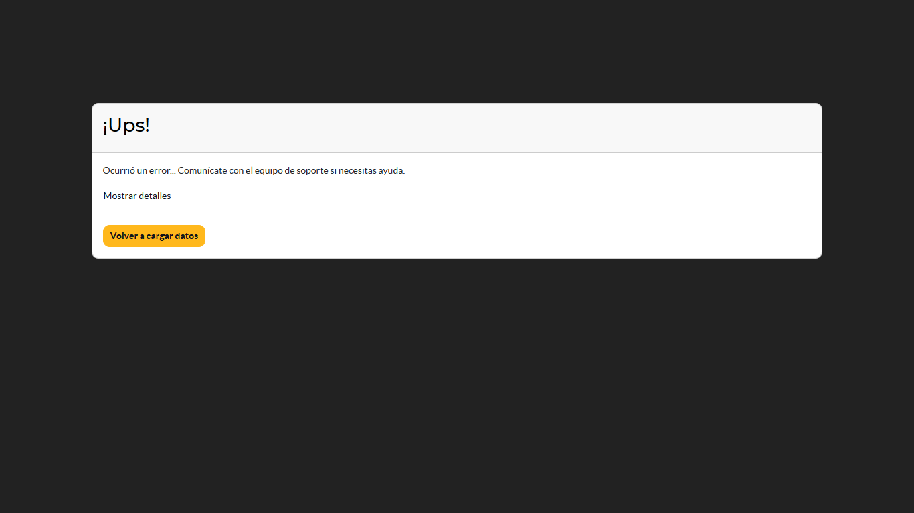

# Instalación y comandos

Todo lo necesario para levantar el entorno local, trabajar con él a diario y ejecutar las pruebas. Los comandos son para la consola **CMD de Windows**, desde la carpeta del repositorio.

- [Qué se instala](#qué-se-instala)
- [Primera vez](#primera-vez)
- [Comandos del día a día](#comandos-del-día-a-día)
- [Aplicar un cambio en un módulo](#aplicar-un-cambio-en-un-módulo)
- [Pruebas](#pruebas)
- [Problemas conocidos](#problemas-conocidos)

## Qué se instala

`docker-compose.yml` define dos contenedores:

| Servicio | Imagen | Para qué |
| --- | --- | --- |
| `db` | `postgres:16` | La base de datos. Sus datos viven en un volumen con nombre |
| `odoo` | `odoo:19` | Odoo. Lee los módulos de la carpeta `addons` del repositorio |

- Odoo se publica solo en `127.0.0.1:8069`: es accesible desde tu PC, no desde la red.
- No tiene política de reinicio: no arranca solo con Windows.
- Las credenciales del archivo (`odoo` / `odoo`) son las de un entorno de desarrollo. **No uses este archivo en producción.**

## Primera vez

1. Abre Docker Desktop y espera a que el motor esté listo. Lo compruebas con `docker version`: debe aparecer la sección "Server".

2. Levanta los contenedores:

   ```cmd
   docker compose up -d
   docker compose ps
   ```

3. Crea la base de trabajo con datos de demostración e idioma español:

   ```cmd
   docker compose run --rm odoo odoo -d regalos_dev -i point_of_sale,stock,sale_management --with-demo --load-language=es_PE --stop-after-init --no-http
   ```

   En Odoo 19 los datos de demostración no se cargan por defecto: hace falta `--with-demo`.

4. Instala los módulos y reinicia:

   ```cmd
   docker compose run --rm odoo odoo -d regalos_dev -i gift_registry_pos,gift_registry_sale,macromec_pos_theme --stop-after-init --no-http
   docker compose restart odoo
   ```

5. (Opcional) Activa las promociones, si vas a probar códigos de descuento o tarjetas de regalo:

   ```cmd
   docker compose run --rm odoo odoo -d regalos_dev -i pos_loyalty --stop-after-init --no-http
   docker compose restart odoo
   ```

6. Entra en <http://localhost:8069>, base `regalos_dev`, usuario `admin`, contraseña `admin`.

## Comandos del día a día

```cmd
docker compose stop        :: apagar (conserva todo)
docker compose start       :: volver a encender
docker compose ps          :: ver si están en ejecución
docker compose logs -f odoo   :: ver el registro de Odoo en vivo (Ctrl+C para salir)
docker compose down -v     :: BORRAR contenedores, red y volúmenes: se pierden las bases
```

`down -v` no borra el código ni los archivos del repositorio.

## Aplicar un cambio en un módulo

Después de editar un módulo, Odoo necesita actualizarlo y reiniciarse:

```cmd
docker compose run --rm odoo odoo -d regalos_dev -u NOMBRE_DEL_MODULO --stop-after-init --no-http
docker compose restart odoo
```

- Al actualizar `gift_registry`, Odoo actualiza también los módulos que dependen de él.
- Si cambiaste estilos o JavaScript de la caja, recarga la caja en el navegador con **Ctrl+F5**.
- Cuando agregas un módulo nuevo a `addons`, reinicia Odoo antes de instalarlo para que lo detecte.

## Pruebas

Las pruebas se ejecutan en una base aparte y desechable, `prueba_regalos`, nunca en la de trabajo. Corren al instalar los módulos, así que la base se borra y se recrea en cada ejecución.

### Las 24 pruebas que no necesitan navegador

```cmd
docker compose exec db dropdb -U odoo --if-exists --force prueba_regalos
docker compose run --rm odoo odoo -d prueba_regalos -i gift_registry_pos,gift_registry_sale,pos_loyalty,macromec_pos_theme --test-tags /gift_registry,/gift_registry_pos,/gift_registry_sale,/macromec_pos_theme --stop-after-init --no-http
```

Al final, busca en la salida una línea como esta:

```
odoo.tests.result: 0 failed, 0 error(s) of 25 tests
```

La prueba número 25 es la de pantalla. Con la imagen oficial de Odoo se **omite sola** (verás `skipped … websocket-client module is not installed`) y no cuenta como fallo.

### La prueba de pantalla (tour)

Abre la caja en un navegador real, busca una lista, agrega un regalo con dedicatoria, cobra y comprueba la leyenda en el ticket. Necesita una imagen con Chrome, que se construye una sola vez (descarga unos 300–400 MB):

```cmd
docker compose -f docker-compose.yml -f docker-compose.pruebas.yml build odoo-pruebas
```

Después, para ejecutar las 25:

```cmd
docker compose exec db dropdb -U odoo --if-exists --force prueba_regalos
docker compose -f docker-compose.yml -f docker-compose.pruebas.yml run --rm odoo-pruebas odoo -d prueba_regalos -i gift_registry_pos,gift_registry_sale,pos_loyalty,macromec_pos_theme --test-tags /gift_registry,/gift_registry_pos,/gift_registry_sale,/macromec_pos_theme --stop-after-init
```

Dos diferencias con el comando anterior: usa el servicio `odoo-pruebas` y **no lleva `--no-http`**, porque el navegador de la prueba necesita el servidor web de Odoo.

La imagen de pruebas es solo para desarrollo. El servicio `odoo` normal sigue usando la imagen oficial.

### Qué cubre cada módulo

| Módulo | Pruebas | Qué comprueban |
| --- | --- | --- |
| `gift_registry` | 14 | Aviso diario (5), productos sugeridos (3), tarjeta PDF (3), datos del dueño y búsqueda (3) |
| `gift_registry_pos` | 7 | Consentimiento, venta y devolución, búsqueda desde la caja, aviso con ventas reales, aviso de exceso, dedicatoria, y el tour |
| `gift_registry_sale` | 2 | Pedido confirmado y cancelado; aviso de exceso |
| `macromec_pos_theme` | 2 | Los estilos de la caja compilan con el tema; cada fuente referenciada existe |

## Problemas conocidos

**La caja muestra "¡Ups! Ocurrió un error…" al abrir**



Si al pulsar "Mostrar detalles" aparece `TypeError: Cannot convert undefined or null to object … restoreState`, la causa es una copia local antigua. La caja guarda en el navegador una copia de los pedidos; si esa copia es anterior a la instalación del módulo de promociones (`pos_loyalty`), al restaurarla falla el código de Odoo.

Solución: pulsa **Volver a cargar datos**. Solo se pierde un ticket que estuviera a medias sin cobrar en ese navegador; las ventas cobradas están en el servidor.

**La caja no reconoce un código de promoción recién creado**

Los programas de promoción se cargan al abrir la caja. Recárgala.

**La caja sigue viéndose con el aspecto antiguo**

El navegador tiene los estilos en caché. Pulsa Ctrl+F5.

**`Invalid tag C:/Program Files/Git/...` al correr pruebas**

Ocurre al lanzar el comando desde **Git Bash**, que convierte los argumentos que empiezan con `/` en rutas de Windows. Usa CMD, o en Git Bash antepón `MSYS_NO_PATHCONV=1`.

**Al reiniciar Odoo aparece `missing --http-interface`**

Es un aviso propio de Odoo 19 y no afecta: Docker publica el puerto solo en `127.0.0.1`.

**`docker version` no muestra la sección "Server"**

Docker Desktop no está abierto. Ábrelo y espera a que termine de arrancar.
